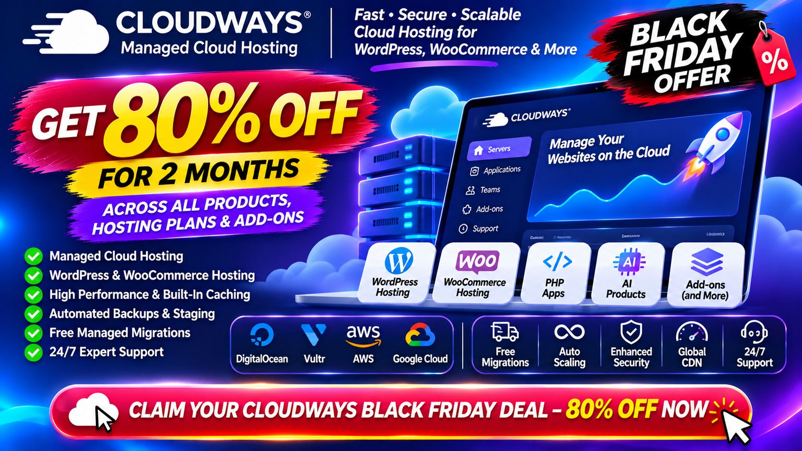

# ☁️ Cloudways Black Friday Deal – Get 80% OFF Managed Cloud Hosting

---

  

  **Looking for fast, reliable, and scalable web hosting without managing complicated servers yourself?**
   
  Discover Cloudways, a managed cloud hosting platform built for WordPress websites, WooCommerce stores, PHP applications, agencies, developers, and growing online businesses.

  🔥 **<a href="https://deal.ink/CloudwaysGH">CLAIM YOUR CLOUDWAYS BLACK FRIDAY DEAL – GET 80% OFF</a>**

---

## 📑 Table of Contents

1. [What Is Cloudways?](#what-is-cloudways)
2. [How Does Cloudways Work?](#how-does-cloudways-work)
3. [Cloudways Hosting Features](#cloudways-hosting-features)
4. [Cloudways Hosting Products](#cloudways-hosting-products)
5. [Who Should Use Cloudways?](#who-should-use-cloudways)
6. [Cloudways vs Traditional Shared Hosting](#cloudways-vs-traditional-shared-hosting)
7. [How to Make the Most of Cloudways](#how-to-make-the-most-of-cloudways)
8. [Cloudways Pricing and Hosting Costs](#cloudways-pricing-and-hosting-costs)
9. [Cloudways Black Friday Offer – 80% OFF](#cloudways-black-friday-offer--80-off)
10. [How to Claim the Cloudways Discount](#how-to-claim-the-cloudways-discount)
11. [Things to Consider Before Buying](#things-to-consider-before-buying)
12. [Frequently Asked Questions](#frequently-asked-questions)
13. [Final Verdict](#final-verdict)
14. [Affiliate Disclosure](#affiliate-disclosure)

---

## What Is Cloudways?

Choosing the right web hosting provider is one of the most important decisions when building an online business.

Your hosting affects website speed, reliability, security, scalability, and the overall experience your visitors receive.

Traditional shared hosting can be a good starting point for small websites, but as your business grows, you may need more server resources, better performance, and greater control.

This is where **Cloudways** comes in.

Cloudways is a managed cloud hosting platform that allows users to deploy websites and applications on cloud infrastructure without having to manage every server-level task themselves.

It combines cloud infrastructure with a simplified hosting dashboard, server management tools, performance optimization, security features, automated backups, and technical support.

Cloudways supports popular applications and technologies, including:

- WordPress
- WooCommerce
- Magento
- Laravel
- PHP applications
- Other supported web applications
- Node.js applications through its Velocity platform

One of the interesting aspects of Cloudways is that you can choose from different cloud infrastructure providers while using Cloudways to manage your hosting environment.

Depending on the product and configuration, supported infrastructure providers include DigitalOcean, Vultr, AWS, and Google Cloud.

Instead of managing a cloud server entirely on your own, Cloudways handles many of the technical hosting responsibilities through its managed platform.

### Why Do Businesses Choose Managed Cloud Hosting?

Imagine running an online store that receives a sudden increase in visitors during a promotional campaign.

With basic hosting, limited resources or poor server configuration could affect website performance.

A managed cloud hosting platform can provide more flexibility to configure resources, optimize applications, and scale infrastructure as your business grows.

Cloudways is designed to help website owners focus more on their websites and businesses instead of spending all their time managing servers.

**Want to explore Cloudways with the current Black Friday discount?**

👉 [Get Cloudways – Claim 80% OFF](https://deal.ink/CloudwaysGH)

---

## How Does Cloudways Work?

Cloudways acts as a management layer between you and the underlying cloud infrastructure.

You select a hosting product and configuration, deploy your application, and manage your websites through the Cloudways dashboard.

Here is a simplified overview of the process.

### Step 1: Create Your Cloudways Account

Start by creating a new account through the promotional link.

Choose the hosting product that matches your requirements.

For example, if you want to host a WordPress blog or business website, you can explore the Flexible or Autonomous hosting options.

### Step 2: Choose Your Hosting Configuration

Depending on the selected product, you can configure resources such as:

- Cloud infrastructure provider
- Server location
- RAM
- CPU
- Storage
- Bandwidth
- Application requirements

Choose a server location close to your target audience when practical.

For example, if most of your visitors are in Canada or the United States, selecting an appropriate North American data centre may help reduce network latency.

### Step 3: Deploy Your Application

Cloudways supports different applications and technologies.

You can deploy supported applications such as WordPress, WooCommerce, Magento, and other PHP applications.

The platform provides application installation and management tools to simplify deployment.

### Step 4: Connect Your Domain

Once your application is deployed, connect your domain name using the required DNS settings.

You can then configure SSL to enable secure HTTPS connections.

Remember that purchasing a domain name may be a separate expense.

### Step 5: Configure Performance and Security

Cloudways provides tools for managing website performance and server security.

Depending on the selected product, you can configure or use features such as:

- Caching
- CDN integration
- Automated backups
- SSL certificates
- Firewalls
- IP access controls
- Application monitoring
- Staging environments

### Step 6: Manage and Grow Your Website

After launching your website, you can manage applications, monitor resources, create backups, and adjust your hosting configuration as your needs change.

Cloudways is designed to support websites as they grow, without requiring you to move to an entirely different hosting management platform every time your requirements change.

---

## Cloudways Hosting Features

Cloudways combines infrastructure management, website performance tools, security features, and application management in one platform.

Here are some of its important features.

### 1. Managed Cloud Hosting

Cloudways handles many of the technical server management tasks that website owners would otherwise need to configure themselves.

This can make cloud hosting more accessible to WordPress users, agencies, and business owners who don't want to manage every server component manually.

### 2. Multiple Cloud Infrastructure Providers

Cloudways supports several cloud infrastructure providers, including:

- DigitalOcean
- Vultr
- Amazon Web Services (AWS)
- Google Cloud

Availability depends on the selected hosting product and configuration.

This flexibility allows users to select infrastructure according to their performance, resource, and budget requirements.

### 3. WordPress Hosting

WordPress is one of the most popular content management systems for building websites.

Cloudways provides managed hosting options designed for WordPress websites.

You can use it for:

- Business websites
- Blogs
- Affiliate websites
- Membership websites
- Portfolio websites
- Online publications
- Content-heavy websites

The platform includes tools for application management, caching, backups, staging, and performance optimization.

### 4. WooCommerce Hosting

Online stores need reliable hosting because website performance can directly affect the shopping experience.

Cloudways provides hosting options designed for WooCommerce stores.

These can help businesses manage:

- Product catalogues
- Customer accounts
- Shopping carts
- Checkout pages
- Online transactions
- Promotional campaigns
- Increasing website traffic

For stores experiencing traffic spikes, the appropriate hosting configuration and autoscaling options can help manage changing resource requirements.

### 5. Autonomous Hosting

Cloudways Autonomous is designed for WordPress and WooCommerce websites that need more automated infrastructure management.

It advertises automatic scaling capabilities to help websites handle changes in traffic.

This may be particularly useful for online stores, publishers, and businesses running websites with unpredictable visitor activity.

### 6. Flexible Hosting

Cloudways Flexible gives users more control over their hosting configuration and underlying cloud infrastructure.

It supports WordPress, Magento, Laravel, and other PHP applications.

You can choose the infrastructure provider and server resources according to your requirements.

This option may suit developers, agencies, and website owners who want greater control over their hosting environment.

### 7. Cloudways Velocity

Cloudways Velocity is designed for modern JavaScript application hosting.

It supports modern development stacks such as Node.js, React, Next.js, and Express.

This makes Cloudways relevant not only to traditional WordPress users but also to developers building modern web applications.

### 8. Free Managed Website Migrations

Moving a website from one hosting provider to another can be stressful.

Cloudways advertises free managed migrations for WordPress and WooCommerce websites.

Its current offer also includes free migration support for other PHP applications when requested within the promotional migration period.

This can help users move existing websites without handling every migration step themselves.

Always confirm migration eligibility and requirements before submitting a request.

### 9. Automated Backups

Backups are essential for protecting website data.

Cloudways provides automated backup functionality to help users recover websites if something goes wrong.

Depending on your configuration, you can manage backup frequency and retention settings.

Having regular backups is particularly important for:

- E-commerce websites
- Business websites
- Membership platforms
- Blogs with frequent updates
- Websites managing customer information

Remember that backup storage and related usage may affect your hosting costs.

### 10. Staging and Cloning

Making changes directly to a live website can create unnecessary risks.

Cloudways provides staging and cloning tools that help users create copies of their applications for testing.

You can use staging environments to:

- Test WordPress updates
- Install new plugins
- Change website themes
- Test custom code
- Check design changes
- Experiment with new functionality

Once everything works as expected, you can deploy the changes to your live website.

### 11. Built-In Caching and Performance Optimization

Website speed is important for user experience and business performance.

Cloudways includes performance technologies and integrations designed to improve application loading times.

Depending on the product and configuration, these may include:

- NGINX
- Varnish
- Redis
- Object caching
- Breeze caching
- Cloudflare Enterprise CDN

The exact features included can vary by hosting product.

### 12. Cloudflare Enterprise CDN

Cloudways offers Cloudflare Enterprise-related performance and security capabilities through supported plans and add-ons.

A content delivery network (CDN) helps deliver website content through geographically distributed infrastructure.

Potential benefits include:

- Improved content delivery
- Reduced latency
- Additional website security
- DDoS protection
- Web application firewall capabilities
- Traffic filtering

Check your selected plan to understand which Cloudflare features are included and which are optional.

### 13. Free SSL Certificates

SSL certificates allow websites to use HTTPS connections.

Cloudways supports SSL installation for applications, helping protect data exchanged between visitors and websites.

HTTPS is important for websites that handle logins, forms, and customer interactions.

### 14. Server Monitoring

Cloudways provides monitoring tools to help users understand server and application performance.

You can monitor available metrics and identify potential resource issues.

This is useful when investigating:

- High CPU usage
- Memory consumption
- Server load
- Storage usage
- Application performance
- Unexpected traffic increases

### 15. Vertical Scaling

As your website grows, you may need additional server resources.

Cloudways supports vertical scaling for supported hosting configurations.

This allows users to increase available resources without necessarily moving the entire website to a completely different hosting provider.

Available scaling options depend on the selected infrastructure and product.

### 16. SSH and Git Integration

Developers may need more control over application deployment and server access.

Cloudways supports developer-oriented tools such as SSH access and Git integration.

These can be useful for:

- Managing application files
- Deploying code
- Working with repositories
- Running supported commands
- Managing development workflows

### 17. Cloudways Copilot

Cloudways Copilot is an AI-powered assistant designed to help users monitor and troubleshoot their hosting environments.

It can analyze server and application information and provide guidance when issues occur.

The current platform also advertises conversational capabilities that can help users investigate infrastructure problems and take supported actions.

This can be useful for website owners who want assistance understanding technical issues without manually reviewing every log.

### 18. Site Manager

Cloudways Site Manager helps users manage multiple WordPress websites from a centralized dashboard.

It is designed to simplify website maintenance and updates.

The Pro tier advertises staging-based update testing, visual comparisons, and automatic rollback when problems are detected.

This may be particularly useful for agencies and freelancers managing several client websites.

### 19. 24/7 Customer Support

Hosting problems can happen at any time.

Cloudways advertises 24/7 support through its support channels.

Support options and access to advanced assistance may depend on the selected support tier.

### 20. Usage-Based Pricing

Cloudways uses usage-based hosting pricing for its Flexible infrastructure.

You pay according to the resources and services you use rather than committing to a traditional long-term prepaid hosting contract.

This can provide flexibility when experimenting with different server configurations.

However, you should monitor usage and additional charges carefully to avoid unexpected costs.

---

## Cloudways Hosting Products

Cloudways offers several products designed for different types of websites, applications, and businesses.

Understanding the differences can help you choose the right option.

### 1. Cloudways Flexible

Flexible is designed for users who want managed hosting with greater control over their infrastructure.

It supports applications such as:

- WordPress
- WooCommerce
- Magento
- Laravel
- PHP applications

You can select supported cloud providers and configure your server resources.

**Best suited for:**

- Bloggers
- Developers
- Freelancers
- Agencies
- Growing businesses
- Website owners managing multiple applications

### 2. Cloudways Autonomous

Autonomous is designed for WordPress and WooCommerce websites that need automated scaling and more hands-off infrastructure management.

It is particularly relevant for websites experiencing changing traffic levels.

**Best suited for:**

- Growing WooCommerce stores
- High-traffic WordPress websites
- Online publishers
- Businesses running important websites
- Websites with unpredictable traffic

### 3. Cloudways Velocity

Velocity focuses on modern JavaScript application hosting.

It supports technologies such as Node.js, React, Next.js, and Express.

**Best suited for:**

- Web developers
- SaaS businesses
- JavaScript developers
- Application builders
- Teams developing modern web applications

### 4. Managed AI Agents

Cloudways also offers managed hosting for AI agents.

This is designed for users who want to deploy supported AI agent applications on managed infrastructure.

**Best suited for:**

- AI developers
- Automation enthusiasts
- Businesses experimenting with AI agents
- Developers deploying agent-based applications

### 5. AI Website Builder

Cloudways offers an AI Website Builder designed to help users create WordPress websites using AI.

It aims to simplify website creation while allowing users to own and manage their websites on the hosting infrastructure.

Check the current availability and pricing conditions for this product.

### 6. Cloudways Add-ons

Cloudways offers additional services and add-ons that can extend the functionality of your hosting environment.

Examples include:

- Cloudflare Enterprise
- Malware Protection
- Site Manager
- Additional performance and security services
- AI-related tools

The availability and pricing of add-ons depend on your hosting product and selected configuration.

---

## Who Should Use Cloudways?

Cloudways can be useful for different types of website owners and businesses.

### 1. Bloggers and Content Publishers

If your blog is growing and shared hosting is no longer meeting your needs, Cloudways may be worth considering.

You can host WordPress websites and configure resources according to your traffic requirements.

It may be useful for:

- Niche blogs
- Technology websites
- News publications
- Affiliate websites
- Content-heavy websites

### 2. Affiliate Marketers

Affiliate marketers depend on their websites to attract visitors and generate conversions.

A slow website can negatively affect user experience.

Cloudways provides hosting and performance tools that may help support growing affiliate websites.

### 3. E-commerce Store Owners

Online stores need reliable hosting for product pages, shopping carts, and checkout processes.

Cloudways offers WooCommerce hosting options and Autonomous infrastructure for supported scaling requirements.

### 4. Digital Marketing Agencies

Agencies often manage multiple websites for different clients.

Cloudways provides application management, staging, cloning, monitoring, and migration tools that can help simplify website management.

### 5. Freelance Web Developers

Developers can use Cloudways to host client projects without managing every server component manually.

SSH access, Git integration, application deployment, and cloud provider flexibility may be particularly useful.

### 6. Small and Medium-Sized Businesses

Businesses that rely on their websites for leads, sales, and customer communication may benefit from managed hosting.

Cloudways provides tools for performance, security, backups, and website management.

### 7. WooCommerce Businesses

Stores experiencing growth may need more resources and better infrastructure management.

Cloudways provides hosting options designed for WooCommerce applications.

### 8. SaaS and Application Developers

Developers building modern applications can explore Cloudways Velocity and its managed application hosting options.

### 9. Web Hosting Resellers and Agencies

Agencies and freelancers managing several client websites may benefit from centralized application management and hosting tools.

---

## Cloudways vs Traditional Shared Hosting

If you're currently using shared hosting, you may wonder whether moving to Cloudways is worthwhile.

Both options serve different needs.

| Feature | Traditional Shared Hosting | Cloudways |
|---|---|---|
| Hosting Infrastructure | Shared server environment | Managed cloud infrastructure |
| Server Resources | Shared according to hosting plan | Configurable cloud resources |
| Server Management | Provider-dependent | Managed through Cloudways |
| Application Support | Depends on hosting provider | Multiple supported applications |
| Cloud Provider Choice | Usually limited | Multiple supported providers |
| Scaling | May require plan changes or migration | Vertical scaling on supported configurations |
| Staging | Depends on provider | Available on supported products |
| Backups | Depends on hosting plan | Managed backup options |
| Developer Tools | Varies | SSH and Git integration |
| Pricing | Often fixed monthly or annual plans | Usage-based Flexible pricing and product-specific plans |
| Best For | Beginners and smaller websites | Growing websites, agencies, and applications |

### Is Cloudways Better Than Shared Hosting?

Not necessarily for everyone.

Shared hosting can be perfectly suitable for a small personal blog or a new website with limited traffic.

Cloudways becomes more interesting when you need:

- More control over server resources
- Better application management
- Cloud infrastructure flexibility
- Staging and cloning
- Advanced performance tools
- Hosting for multiple websites
- More scalable infrastructure

You should choose hosting based on your website's actual requirements rather than paying for resources you don't need.

---

## How to Make the Most of Cloudways

Choosing a hosting provider is only the first step.

To get the most value from your Cloudways account, you should configure your website properly.

### 1. Choose the Right Server Size

Don't automatically select the largest server.

Consider your website's traffic, application requirements, plugins, and expected resource usage.

You can adjust resources later when your needs change.

### 2. Select a Suitable Data Centre

Choose a data centre close to your primary audience when practical.

This can help reduce network latency.

### 3. Enable Automated Backups

Set up a backup schedule that matches how frequently your website changes.

If you run an online store or publish content regularly, frequent backups can be particularly important.

### 4. Use Caching Properly

Configure available caching options and test your website after making changes.

Avoid enabling multiple overlapping caching systems without understanding how they interact.

### 5. Use Staging Before Major Updates

Test major plugin updates, theme changes, and custom code on a staging copy before deploying them to your live website.

### 6. Monitor Server Resources

Check CPU, memory, storage, and other available metrics.

If your website becomes slow, monitoring information can help identify potential resource limitations.

### 7. Keep WordPress Updated

Regularly update WordPress, plugins, and themes.

Remove unused extensions and use reputable software.

### 8. Review Your Hosting Costs

Cloudways uses usage-based billing for Flexible hosting.

Monitor server usage, add-ons, storage, and other billable services to understand your monthly costs.

### 9. Use a CDN When Appropriate

A CDN can help deliver static website content more efficiently to visitors in different locations.

Review the available CDN options and whether they are included in your selected plan.

### 10. Test Website Performance

Use tools such as Google PageSpeed Insights to review website performance.

Remember that hosting is only one factor. Themes, plugins, images, scripts, and website configuration also affect loading speed.

---

## Cloudways Pricing and Hosting Costs

Cloudways uses different pricing models depending on the product you select.

Its Flexible hosting uses usage-based pricing, while other products and services may have separate pricing structures.

### Flexible Hosting Pricing

The published pricing page lists example DigitalOcean Flexible server configurations such as:

| Server Configuration | Advertised Monthly Price |
|---|---:|
| 1 GB RAM | $14 USD |
| 2 GB RAM | $28 USD |
| 4 GB RAM | $54 USD |
| 8 GB RAM | $99 USD |

These are example configurations, not universal prices for every cloud provider or server location.

Actual prices depend on the selected infrastructure, server size, location, and additional services.

### What Is Included?

Depending on the hosting product and configuration, Cloudways offers features such as:

- Managed cloud hosting
- Application deployment
- SSL support
- Automated backups
- Server monitoring
- Staging and cloning
- Performance optimization
- Security tools
- Technical support

Some premium features and add-ons may have separate charges.

### Does Cloudways Charge by the Hour?

Cloudways Flexible advertises hourly usage-based billing.

This means your hosting charges are calculated according to the resources and time used, with invoices issued according to the billing cycle.

This can be useful when testing different configurations or running temporary projects.

However, remember that server usage, add-ons, backups, and other services can affect your final bill.

### Do I Need to Buy a Domain Separately?

Yes, you should budget for a domain name if you don't already own one.

Cloudways is primarily a hosting platform, not a traditional domain registrar.

You can purchase your domain through a domain registrar and connect it to your Cloudways application.

### Is Email Hosting Included?

Do not assume that traditional email hosting is included with your Cloudways server.

If you need professional email addresses such as info@yourdomain.com, you may need a separate email hosting provider or email service.

---

## Cloudways Black Friday Offer – 80% OFF

If you have been thinking about moving your website to managed cloud hosting, this Black Friday promotion is worth exploring.

Cloudways is advertising an 80% discount for the first two months across its products, hosting plans, and add-ons.

The promotion includes:

- Cloudways Flexible
- Cloudways Autonomous
- Cloudways Velocity
- Managed AI Agents
- AI Website Builder
- Cloudways Copilot
- Eligible hosting add-ons

### Black Friday Deal Details

| Offer Detail | Information |
|---|---|
| Discount | 80% OFF |
| Discount Duration | First 2 months |
| Promo Code | BFCM802 |
| Maximum Monthly Savings | $200 |
| Maximum Total Savings | $400 |
| Eligibility | New customers |
| Offer Deadline | December 4 |
| Free Migrations | Unlimited WordPress and WooCommerce migrations |

### Additional Migration Benefits

The Black Friday promotion also advertises unlimited free managed migrations.

WordPress and WooCommerce migrations are included.

For other PHP applications, free migration requests must be submitted within the advertised migration period.

### Additional Add-on Discount

Cloudways also advertises an additional benefit for eligible add-ons.

If you subscribe to an add-on during the campaign, you can receive 20% off that add-on for the remaining 10 months, subject to the offer terms.

### Important Eligibility Conditions

The 80% discount is intended for new Cloudways customers.

The offer terms define new-customer eligibility based on account details such as email, payment method, domain, and organization.

Existing customers may not qualify.

The discount is also capped at $200 per month, so the actual savings depend on your invoice.

**Important:** The 80% discount applies to the first two months only. Standard pricing and applicable charges resume afterward. Review the offer terms and your estimated ongoing hosting costs before signing up.

---

## How to Claim the Cloudways Discount

Claiming the Black Friday offer is straightforward.

### Step 1: Visit the Promotional Link

Start with the following link:

🔥 [CLAIM YOUR CLOUDWAYS 80% OFF DEAL](https://deal.ink/CloudwaysGH)

If the first promotional link does not work, use this alternative:

👉 [ALTERNATIVE CLOUDWAYS PROMOTIONAL LINK](https://deal.ink/CloudwaysGH1)

### Step 2: Create a New Account

Register for a new Cloudways account using the eligible account details.

Remember that this promotion is for new customers.

### Step 3: Choose Your Hosting Product

Select the product that matches your requirements.

For example:

- Flexible for managed cloud hosting with configurable resources.
- Autonomous for WordPress and WooCommerce websites with automated scaling.
- Velocity for modern JavaScript applications.
- Managed AI Agents for supported AI agent applications.

### Step 4: Enter the Promo Code

Use the following promotional code when prompted:

`BFCM802`

Make sure the discount is applied before completing your purchase.

### Step 5: Verify the Discount

Review your invoice and confirm that the 80% discount has been applied correctly.

Remember to check the discount cap, eligible products, and billing terms.

### Step 6: Deploy Your Website

Once your account and hosting environment are ready, deploy your application or request an eligible managed migration.

---

## Things to Consider Before Buying

Cloudways offers powerful hosting tools, but it may not be the right solution for every website.

Here are some things to consider.

### 1. Cloudways Is Not Traditional Shared Hosting

If you only need a simple personal blog with very little traffic, an inexpensive shared hosting plan may be sufficient.

Cloudways is more interesting when you need greater control, performance, and flexibility.

### 2. Understand Usage-Based Billing

Flexible hosting uses usage-based pricing.

Monitor your server configuration, add-ons, storage, and other billable services to avoid unexpected charges.

### 3. The Black Friday Discount Is Temporary

The 80% discount applies for the first two months only.

Calculate your expected costs after the promotional period.

### 4. Domain and Email Services May Be Separate

You may need to purchase a domain and email hosting separately.

Include these costs in your overall website budget.

### 5. Some Features Are Product-Specific

Not every Cloudways product includes identical features.

Compare Flexible, Autonomous, Velocity, and other services before choosing.

### 6. Managed Hosting Does Not Eliminate Every Technical Task

Cloudways manages many infrastructure responsibilities, but you are still responsible for your application, website content, plugins, user access, and configuration.

### 7. Choose the Right Resources

More server resources are not automatically better.

Start with a suitable configuration and monitor performance before upgrading.

---

## Frequently Asked Questions

### 1. What is Cloudways?

Cloudways is a managed cloud hosting platform that allows users to deploy and manage websites and applications on supported cloud infrastructure through a simplified hosting dashboard.

### 2. Is Cloudways good for WordPress?

Yes. Cloudways offers managed WordPress hosting with application management, backups, staging, caching, and performance tools.

### 3. Does Cloudways support WooCommerce?

Yes. Cloudways offers hosting options designed for WooCommerce stores, including Autonomous hosting for supported scaling requirements.

### 4. Which cloud providers does Cloudways support?

Cloudways supports infrastructure providers including DigitalOcean, Vultr, AWS, and Google Cloud, depending on the product and configuration.

### 5. Is Cloudways suitable for beginners?

Cloudways simplifies many server management tasks, but it is more technical than basic shared hosting.

Beginners can use it, although some familiarity with domains, DNS, WordPress, and website management can be helpful.

### 6. Does Cloudways provide free website migration?

Yes. Cloudways advertises free managed WordPress and WooCommerce migrations.

The current Black Friday promotion also includes migration benefits for eligible PHP applications, subject to the stated request deadline and terms.

### 7. Does Cloudways provide free SSL?

Yes. Cloudways supports SSL installation for applications, helping websites use secure HTTPS connections.

### 8. Does Cloudways include backups?

Yes. Cloudways provides automated backup functionality.

Backup settings, retention, and related storage costs depend on your configuration.

### 9. Can I host multiple websites on Cloudways?

Yes. Cloudways supports multiple applications on a server, subject to server resources and product-specific limitations.

### 10. Does Cloudways offer hourly billing?

Yes. Flexible hosting advertises usage-based hourly pricing with billing according to the applicable invoice cycle.

### 11. Does Cloudways include a CDN?

Cloudways offers CDN-related functionality and Cloudflare Enterprise options through supported products and add-ons.

Check the selected plan for included features and additional costs.

### 12. Can I use Cloudways for an online store?

Yes. Cloudways supports WooCommerce and offers hosting options designed for online stores.

### 13. Is Cloudways good for agencies?

Cloudways can be useful for agencies managing multiple client websites because of its application management, staging, cloning, monitoring, and migration tools.

### 14. What is Cloudways Autonomous?

Autonomous is a managed WordPress and WooCommerce hosting product designed to automate infrastructure scaling for supported websites.

### 15. What is Cloudways Velocity?

Velocity is Cloudways' managed hosting platform for modern JavaScript applications such as Node.js, React, Next.js, and Express.

### 16. What is Cloudways Copilot?

Cloudways Copilot is an AI-powered assistant designed to help users monitor, investigate, and troubleshoot server and application issues.

### 17. Does Cloudways provide customer support?

Yes. Cloudways advertises 24/7 customer support. Advanced support options may depend on the selected support tier.

### 18. How much can I save with the Black Friday offer?

Eligible new customers can receive 80% off their first two months, capped at $200 per month, for a maximum advertised saving of $400 across both months.

### 19. What is the Cloudways Black Friday promo code?

The advertised promotional code is `BFCM802`.

Enter it during the signup or checkout process and verify that the discount has been applied.

### 20. Does the Black Friday offer apply to existing Cloudways customers?

No. The current Black Friday promotion is intended for eligible new customers. Review the official offer conditions for the full eligibility requirements.

### 21. Does the discount continue after two months?

No. The 80% promotion applies to the first two months only. Standard pricing and applicable charges resume afterward.

### 22. When does the Cloudways Black Friday offer end?

The advertised campaign ends December 4. Confirm the deadline and applicable time zone during signup.

### 23. Can I use the Cloudways discount on add-ons?

Yes. The promotion advertises 80% off eligible add-ons during the first two months, subject to the campaign terms. Eligible add-ons subscribed to during the campaign may also receive the additional 20% discount for the remaining 10 months.

### 24. Do I need a credit card to try Cloudways?

Cloudways advertises a free trial for eligible products. The current trial length and payment requirements depend on the selected product.

---

## Final Verdict

Cloudways is a managed cloud hosting platform designed for website owners, developers, agencies, and businesses that need more flexibility than traditional shared hosting.

Its combination of cloud infrastructure, application management, automated backups, staging, monitoring, security features, performance optimization, and technical support makes it worth considering for growing websites and online businesses.

For WordPress and WooCommerce users, Cloudways provides hosting options designed to support business websites and online stores.

Developers can also explore Flexible and Velocity for PHP and modern JavaScript applications.

The Black Friday promotion makes the offer particularly interesting for eligible new customers.

With 80% off the first two months, up to $400 in total savings, and advertised free managed migrations, it provides an opportunity to try Cloudways at a significantly reduced introductory cost.

However, remember that the discount is temporary. Before signing up, choose the right hosting product, understand the regular pricing, and calculate your expected costs after the promotional period.

If you're ready to explore managed cloud hosting, check the Cloudways Black Friday offer below.

🚀 **[GET CLOUDWAYS – CLAIM 80% OFF NOW](https://deal.ink/CloudwaysGH)**

If the promotional link above does not work, try the alternative:

👉 [TRY THE ALTERNATIVE CLOUDWAYS OFFER](https://deal.ink/CloudwaysGH1)

---

## Affiliate Disclosure

This article contains affiliate links to Cloudways.

If you sign up through either promotional link and make a qualifying purchase, I may earn a commission at no additional cost to you.

The purpose of this guide is to help readers understand Cloudways hosting products, features, potential use cases, pricing, and promotional terms before making a purchasing decision.

Hosting prices, server configurations, product features, add-on costs, migration eligibility, and promotional discounts may change. Always review the current checkout details and applicable terms before completing your registration.
